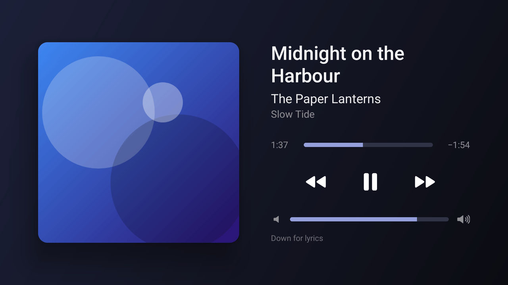

# AirPlay TV

**Screen mirroring from iPhone and iPad to Android TV, the way a TV with built-in AirPlay does it.**

Open Control Center on the iPhone, tap *Screen Mirroring*, pick your TV — the phone's
screen appears on the TV. Play music to it, and the TV shows what is playing. No app to
open on the TV first, no account, no cloud.


AirPlay TV is a small, open-source AirPlay receiver for Android TV and Google TV. It runs
as a background service, starts with the TV, announces itself on the local network and
brings up the picture automatically when a sender connects. Video is decoded by the TV's
hardware decoder straight onto the screen. The APK is about 400 KB.

## Features

- **Screen mirroring** from iPhone, iPad and Mac
  - H.264 up to 1080p60 by default
  - H.265 up to 4K on TVs with a hardware HEVC decoder (Advanced → Resolution Limit → 4k)
  - Portrait and landscape, rotation and resolution changes while mirroring
  - Picture pauses and resumes with the sender (lock screen, app switches)
- **Audio** during mirroring (AAC-ELD) and as an AirPlay speaker for music (ALAC, AAC-LC),
  volume controlled from the sender
- **Now Playing** for music: cover, title, artist and album, progress, volume, a backdrop
  tinted by the cover, and transitions in the direction of travel. The TV remote pauses and
  skips on the phone (also from other apps, through the system's media keys). Optional
  time-synced lyrics. The screen protects OLED panels: it drifts slowly, dims, turns into a
  small wandering card and goes black during long pauses
- **Photos** from the Photos app, full screen with a dissolve between pictures
- **Turns the TV on** when a sender connects while it is in standby (over HDMI-CEC on
  streaming sticks), and optionally back off a few minutes after the music
- **Updates on the TV**: Advanced → Software Update installs a new release from GitHub,
  verified against its checksums, without a USB drive or a computer
- **Always available**: starts on boot, survives app updates and process restarts,
  re-announces itself after network changes and when the TV wakes up
- **Low latency**: hardware decoding into the display surface, vendor low-latency decoder
  modes where available, only the newest picture is shown, small audio buffer
- **Optional PIN pairing**: first connection of each iPhone requires the code shown on the
  TV, afterwards it is remembered; pairing can be reset at any time
- **Performance overlay** (fps, bitrate, decode time, latency, drops) and a diagnostics export
- **Private by design**: local network only, no analytics; the internet is used only for
  what you ask for (see [Privacy](#privacy))

## Status

Version 0.2.0 adds music, photos and updates on the TV. The protocol core — pairing, PIN
pairing, session setup, the encrypted mirror and audio streams, track info, photos and all
parsers of network input — is covered by unit, loopback and fuzz tests that run on every
commit. The app has been run end to end on an Android TV emulator with a protocol-level test
sender: discovery, mirroring with audio, music with track info, cover, pause and track
changes, PIN pairing, autostart after a reboot, recovery after the process is killed, and an
update installed from a GitHub release. How iPhones report pauses and their remote-control
service follows what the [fork](#thanks) these features come from found with real iPhones;
photos follow the protocol notes and have not been confirmed with an iPhone yet. Reports
from real TVs and iPhones are very welcome; please attach the diagnostics export
(Advanced → Export Diagnostics).

## Install

1. Download `AirPlayTV-v<version>-arm64.apk` from the
   [latest release](../../releases/latest). Use `armv7` for older 32-bit TVs, `x86_64` for
   emulators, or `universal` if unsure.
2. Install it with a file manager or a downloader app (allow installing unknown apps), or
   from a computer: `adb install AirPlayTV-v0.1.0-arm64.apk`.
3. Open **AirPlay TV** once. The status turns to *Ready*.
4. Select **Open Automatically → Allow** and allow *Display over other apps*. Android 10 and
   later require this permission before a background app may show the picture by itself.
   If your TV has no such setting in its menus, enable it once from a computer:

   ```
   adb shell appops set io.github.besliky.airplaytv SYSTEM_ALERT_WINDOW allow
   ```

5. On the iPhone: **Control Center → Screen Mirroring → AirPlay TV**.

From then on nothing needs to be opened on the TV. Press **Back** on the remote to stop
mirroring; pressing **Home** leaves the session (and its audio) running in the background.
While music plays, play/pause, left and right on the remote control the phone, and Down
shows the lyrics when they are on.



### Updates

**Advanced → Software Update** looks for a newer release, shows what changed and installs
it. The first time, Android asks to allow AirPlay TV to install apps; Google TV may also
show a Play Protect notice for apps from outside the Play Store (**More details → Install
anyway**). Updates install only over a version signed with the same key, i.e. the APKs
from the releases page. Test versions (`-rc.1` and the like) are offered only to a TV that
runs a test version.

## Settings

| Setting | |
|---|---|
| Device Name | Name shown on the iPhone (default *AirPlay TV*) |
| AirPlay | Turns the receiver on or off |
| Require PIN | Ask for a code on first connection of each device |
| Start Automatically | Start the receiver when the TV boots |
| Show Connection Info | Show the TV's IP address on screen |
| Open Automatically | Permission to show the picture as soon as mirroring starts |
| Music | Lyrics, Sleep After Music, Remote Volume Keys (see below) |
| Advanced | Preferred decoder, resolution limit (720p / 1080p / 4k), frame rate (30 / 60), performance overlay, detailed logs, export diagnostics, paired devices, reset pairing, licenses, software update |

**Music**

- **Lyrics** (off by default): time-stamped lyrics from [LRCLIB](https://lrclib.net) for the
  song that is playing. Only its title and artist are sent.
- **Sleep After Music** (off, 2, 5, 10 or 20 minutes): when AirPlay turned the TV on and
  nobody used the remote, the TV goes back to sleep this long after the music ends. Android
  allows that only to an accessibility service, which has to be switched on once from a
  computer (it receives no events and cannot read the screen):

  ```
  adb shell settings put secure enabled_accessibility_services io.github.besliky.airplaytv/io.github.besliky.airplaytv.service.SleepService
  adb shell settings put secure accessibility_enabled 1
  ```

  If other accessibility services are on already, add this one to the colon-separated list.
- **Remote Volume Keys** (TV or AirPlay): for streaming sticks whose volume buttons change
  nothing you can hear (the stick leaves the volume to the TV over HDMI-CEC, which some TVs
  ignore). With *AirPlay*, the buttons change the AirPlay volume while something plays.


## Compatibility

- **TV**: Android TV / Google TV with Android 8.0 (API 26) or newer. Phones and tablets
  work as well.
- **CPU**: arm64-v8a (recommended), armeabi-v7a, x86_64.
- **Senders**: iPhone, iPad and Mac. The receiver implements the AirPlay mirroring
  protocol in the same way as [UxPlay](https://github.com/FDH2/UxPlay), which works with
  current iOS, iPadOS and macOS releases.

Android 8.0 is the minimum because it is the first release with everything the pipeline
relies on without compatibility layers: notification channels for the background service,
`AImageReader` private surfaces (used to keep the decoder running while the playback
screen is hidden), `AMediaCodec_setOutputSurface` and adaptive icons. Android TV devices
still on 7.x are rare.

## Limitations

- **Protected content**: apps that forbid screen recording (Netflix, Apple TV+, Disney+ and
  similar) show a black screen or stop mirroring. This is enforced on the iPhone and is not
  a receiver problem.
- **Not supported**: AirPlay 2 multi-room audio, AirPlay "video" URL playback (e.g. the
  AirPlay button inside some video apps, which uses HLS instead of mirroring), photo
  slideshows, HomeKit pairing. Mirroring, AirPlay audio and photos work.
- **One sender at a time**: a new sender replaces the current one.
- **Sleeping TVs**: in a standby mode that keeps the network up, the TV is turned on when a
  sender connects. AirPlay cannot wake a TV that has powered its network down.
- **Opening automatically** needs the *Display over other apps* permission on Android 10+
  (see Install). Without it a notification offers to open the picture.
- **Audio/video sync**: both streams are played with minimal delay rather than being
  aligned to a common clock, which keeps latency low but leaves lip sync to the similar
  pipeline delays of both paths.

## Privacy

AirPlay TV works inside your local network and needs no internet connection.

- No analytics, telemetry, crash reporting, advertising, accounts or cloud services.
- On its own, the app only announces itself over Bonjour (mDNS) through Android's service
  discovery, accepts AirPlay connections and, while music plays, sends the remote's
  play/pause and skip commands to the phone. Connections from outside the TV's local subnet
  are refused.
- It goes to the internet only when you ask: **Software Update** asks GitHub
  (api.github.com, github.com) for releases when you select it, and **Lyrics**, when you
  turn it on, sends the title and artist of the playing song to lrclib.net.
- The receiver's pairing key is encrypted with a key held in the Android Keystore. Paired
  devices are stored as public keys only. Backups are disabled.
- Diagnostics are written to the app's own storage on the TV and are never sent anywhere;
  they contain no keys, PINs or device names.

## How it works

```
iPhone ──mDNS──▶ Android NSD (_airplay._tcp, _raop._tcp)
   │
   ├──RTSP/TCP──▶ native receiver (C, libairplaytv.so)
   │                ├─ pairing (Ed25519/X25519, SRP PIN), FairPlay setup
   │                ├─ mirror stream (TCP, AES-CTR) ──▶ AMediaCodec ──▶ Surface
   │                ├─ audio (RTP/UDP, AES-CBC) ──▶ AAC/ALAC ──▶ AudioTrack
   │                ├─ track info, cover, progress (SET_PARAMETER)
   │                └─ photos (HTTP PUT /photo)
   ◀──DACP/HTTP── play/pause and skip from the TV remote

BootReceiver ──▶ ReceiverService (foreground) ──▶ NetworkMonitor, Advertiser
                        ├── MirrorActivity (full-screen surface, PIN, overlay)
                        ├── NowPlayingActivity (music) and PhotoActivity
                        └── NowPlayingTracker, MediaKeys, DacpClient
```

The protocol core is C; decoding and rendering use the NDK media APIs, so video never
passes through Java. See [docs/ARCHITECTURE.md](docs/ARCHITECTURE.md) for threads, the
latency policy, lifecycle handling and security measures.

## Building

Requirements: JDK 17, Android SDK platform 36 and build-tools 36, NDK 28.2.13676358,
CMake 3.22.1 (Gradle downloads what is missing).

```
./gradlew assembleDebug          # debug APKs in app/build/outputs/apk/debug
./gradlew packageReleaseApks     # release APKs + SHA256SUMS in app/build/dist
./gradlew testDebugUnitTest lintRelease
```

Release builds are signed with your debug key unless a release key is configured, so a
local release build installs straight away. To sign with your own key, create
`keystore.properties` in the project root (it is git-ignored):

```
storeFile=/path/to/release.jks
storePassword=...
keyAlias=...
keyPassword=...
```

Native tests and fuzzers (Linux or macOS, clang):

```
cmake -S core -B build -DAIRPLAYTV_TESTS=ON -DAIRPLAYTV_SANITIZE=ON && cmake --build build
ctest --test-dir build --output-on-failure
cmake -S core -B build-fuzz -DCMAKE_C_COMPILER=clang -DAIRPLAYTV_TESTS=ON -DAIRPLAYTV_FUZZ=ON
cmake --build build-fuzz && ./build-fuzz/tests/fuzz_rtsp -max_total_time=60
```

See [docs/TESTING.md](docs/TESTING.md) for the test sender that streams a generated
picture to a running receiver, and [docs/RELEASING.md](docs/RELEASING.md) for CI and
release signing.

## Project layout

```
app/        Android app (Kotlin, no AndroidX): service, discovery, UI
core/src/   protocol core (RTSP, pairing, FairPlay setup, mirror and audio streams)
core/android/  JNI bridge, AMediaCodec video decoder, audio pipeline
core/third_party/  vendored Mbed TLS subset, Monocypher, playfair, ALAC decoder
core/tests/ unit, loopback and fuzz tests, test sender
docs/       architecture, testing, releasing
```

## Thanks

The music, photo and wake features of version 0.2.0 were inspired by the fork
[geekylaneorgcf/airplay-tv](https://github.com/geekylaneorgcf/airplay-tv) by Ashish Jullia,
who turned this receiver into a music player for a Fire TV Stick on an OLED TV and worked
out on real hardware how iPhones report track info, pauses and the remote-control service.
The Now Playing screen, its OLED care, the lyrics, sleep after music, the remote volume keys
and the photo viewer follow their design, and their work was the starting point for this
release. Thank you!

## License

AirPlay TV is free software under the GNU General Public License v3.0 or later
(see [LICENSE](LICENSE)). It builds on UxPlay, playfair, Mbed TLS, Monocypher and an ALAC
decoder — see [THIRD_PARTY_LICENSES.md](THIRD_PARTY_LICENSES.md).

AirPlay, Apple TV, iPhone and iPad are trademarks of Apple Inc. This project is an
independent implementation and is not affiliated with or endorsed by Apple.
